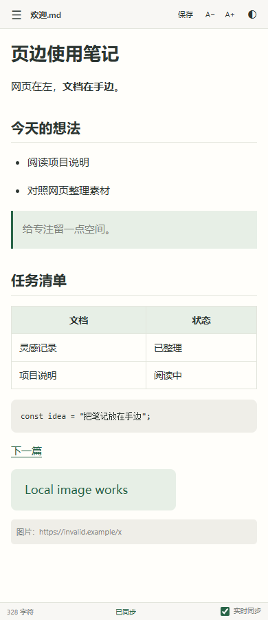
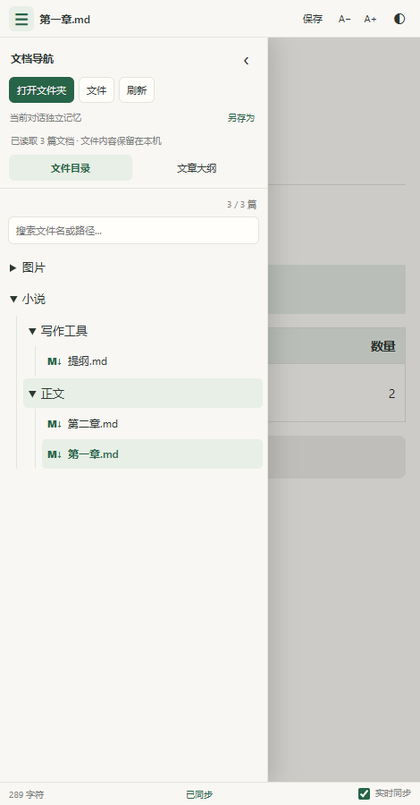

# 页边 · 本地 Markdown

在 ChatGPT 网页旁，阅读和直接编辑自己的本地 Markdown 文档。

当前版本 **1.3.0** · Chrome 116 及以上桌面版 · Manifest V3

## 功能

- 每个 ChatGPT 对话独立记住文件夹、当前文档和阅读位置。
- 点击排版后的正文直接编辑，支持标题、列表、引用、表格、代码块与常用格式快捷键。
- 停笔后自动保存到本地文件，支持手动保存和另存为。
- 展开文件夹树、搜索文件名或路径，通过文章大纲跳转。
- 同步外部编辑器的修改；双方都有修改时，保留草稿并提供版本选择。
- 显示目录内的本地图片，支持相对文档链接、明暗主题和字号调整。

## 下载与安装

1. 下载 [v1.3.0 安装包](downloads/yebian-markdown-v1.3.0.zip)，解压并保留 `md-sidebar` 文件夹。
2. 在 Chrome 打开 `chrome://extensions`，开启「开发者模式」。
3. 选择「加载已解压的扩展程序」，选中包含 `manifest.json` 的 `md-sidebar` 文件夹。
4. 打开 [ChatGPT](https://chatgpt.com/)，点击工具栏中的「页边」扩展图标。
5. 展开顶部「☰」，选择「打开文件夹」，按浏览器提示授予本地文件读写权限。

通过 Git 克隆或 GitHub 的 Download ZIP 获取仓库时，直接加载仓库里的 `extension` 文件夹即可。打包后的编辑器随代码提供，安装使用可直接完成。

Chrome 从加载位置读取扩展文件，请长期保留该文件夹。更新文件后，在扩展管理页点击刷新，再重新打开侧栏。

## 界面预览

下图使用示例内容展示实际扩展界面。

 

## 数据与权限

`sidePanel` 权限用于打开浏览器侧栏；`https://chatgpt.com/*` 权限用于识别 ChatGPT 标签页地址，按对话地址恢复各自的工作区。

文档由用户选择并授权访问。Markdown 解析、编辑、草稿和版本备份均在本机处理；工作区与文件句柄保存在扩展的 IndexedDB，偏好和草稿快速副本保存在扩展本地存储。脚本和编辑器依赖随扩展打包，网络图片以文字占位展示。用户主动打开网络链接时，浏览器会访问相应网站。

支持 UTF-8 文档，单篇大小上限 10 MB。写回时保留换行方式和 UTF-8 BOM；修改过的文本块按结构生成 Markdown，其他块保留原始写法。与外部程序高频同时编辑时，可使用版本选择和另存为保留各份内容。

## 开发与验证

使用支持当前依赖的 Node.js 版本（建议 Node.js 22 或以上）：

```sh
npm ci
npm run build
npx playwright install chromium
npm test
```

测试使用独立 Chromium 配置目录和测试文件句柄，覆盖站点范围、Markdown 渲染、直接编辑与保存、外部同步、冲突恢复、文件夹树和窄屏布局。实际系统文件选择器和目录授权按安装步骤体验。

可通过 `PLAYWRIGHT_CHROMIUM_EXECUTABLE_PATH` 指定已有的 Chromium 可执行文件。测试截图保存在 `test-artifacts/`，浏览器临时配置保存在 `tests/*profile-*/`。

## 目录

- `extension/`：可以直接加载的扩展，以及编辑器源码和示例文档。
- `scripts/build-editor.cjs`：构建编辑器，收集依赖版本与许可证。
- `tests/`：浏览器集成测试。
- `downloads/`：便于手动安装的版本包。
- `docs/`：界面预览。

完整使用说明和验证范围见 [扩展说明](extension/README.md)。第三方依赖许可证与版本见 [vendor/licenses](extension/vendor/licenses/)。
